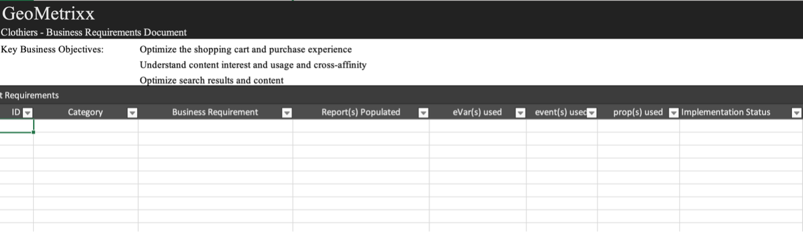
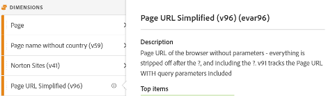
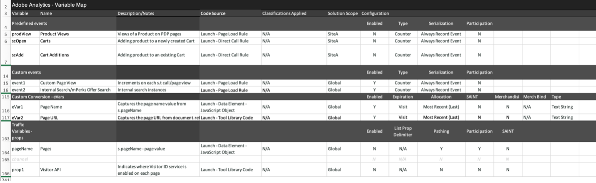
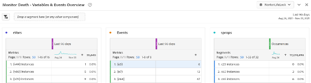

# [!DNL Adobe Analytics]実装プレイブックのダウンロード

開始する前に、[&#x200B; プレイブックをダウンロード &#x200B;](assets/aa-implementation-playbook.xlsx)してください。

## 「Business Requirements」タブ

**WHAT:** ビジネス要件ドキュメント （一般的にBRDと呼ばれます）は、主要な関係者、ビジネスユーザー、技術ユーザーが共同作業を行う際に必要となる非常に重要なドキュメントです。 目的のKPI、レポート要件、および[!DNL Adobe Analytics] （AA）の実装が完了したときに確認する任意のデータポイントをすべて文書化する場所です。

**WHY:**&#x200B;これは、以下のドキュメント（SDR、技術仕様など）の出発点となります。 最終的に合意した州レベルでの信頼できる唯一の情報源であることが重要です。 このドキュメントでは、組織内のチーム間で考えを整理し、導入を構築または強化するための指針を形成します。

**方法：** ビジネス要件の文書化は、AAのエンドビジネスユーザーによって一般的に行われますが、注意すべき技術的な課題があり、特定のデータポイントが他のデータポイントよりも多くの労力を必要とする可能性があるため、テクノロジーユーザーからフィードバックを得ることが重要です。優先順位付けの要因となります。

「サイト上で追跡したい項目は何か」、「レポートの使用において自分にとって重要なデータポイントは何か」、そして最も重要なことは「これらのデータポイントがどのように意思決定に役立つのか」を自問します。 各ビジネス要件が、ビジネス上の意思決定に活用できるデータポイントに関連していることを確認することが重要です。 例えば、web サイトのあらゆるクリックを追跡したいと考えるかもしれませんが、結局のところ、そのレポートから得られるインサイトは何でしょうか？

以下のスクリーンショットのC列に入力して開始します（ビジネス要件）。 これは、「サイトで完了した内部検索の数」や「インプレッションという点で最も効果的な内部キャンペーンスポット」のようなものです。 この詳細レベルを入力したら、戻って列B （カテゴリー）に入力し、要件を「検索」や「社内プロモーション」などのカテゴリにグループ化します。これらのカテゴリは、技術仕様のセクションと適切に対応する必要があります。

また、eVar、イベント、prop、または組み合わせを使用することで、追跡したいものを達成できるかどうかを示します。

最後に、「実装ステータス」列は、サイトに追加を開始する際のステータスチェックとして機能します。

## 「バリアブルマップ」タブ（doc/SDRへのタグ付け）

**WHAT:** タグ付けドキュメント （一般的にSDRと呼ばれます）は、AAの技術ユーザーとビジネスユーザーの両方にとって価値のある重要なドキュメントです。 レポートスイートで使用されているあらゆる変数と、変数設定に関するすべての関連詳細、変数の実装方法、レポートでの目的が一覧表示されます。 プロパティのドキュメントと同様に、タグ付けの強化や実装の変更が行われた場合に、そのドキュメントを最新の状態に保つ責任のある担当者が配置された、生き生きとした適切に管理されたExcel ドキュメントを作成します。

**理由：**&#x200B;このドキュメントは多くの目的に役立ちますが、最も重要なのは次のとおりです。

* 導入を初めて行うユーザー（新規採用、利用可能なレポートをより深く理解したいビジネスオーナーなど）向け このドキュメントでは、実装されているすべての変数とその目的を最適に表示し、個人がAA設定を学ぶことに関してセルフサービスで作業できるようにします。
* プロダクトオーナー/技術ユーザーの場合、このドキュメントは、新しいディメンションを追加する際に、他の変数がどのように設定され、どの変数を使用できるかを示すリマインダーとして機能します。

**方法：**&#x200B;まず、すべての[!DNL Adobe]標準変数（ページ、製品、地域など）、およびeVar、prop、イベント、およびリスト変数をExcel ドキュメントに一覧表示します。 これには、サイト/レポートスイートごとに1つのタブが必要です。
これらのディメンションごとに、次の列を追加します。

* **名前：**&#x200B;ほとんどのユーザーが理解できる、シンプルで短い名前を指定します。 これは、新しいユーザーが変数を選択し、その変数が何をキャプチャするのかを理解できるほど直感的なものである必要があります。
* **説明：**&#x200B;変数の使用目的と追跡するデータに関する詳細。 これは短くシンプルで、インターフェイスで使用される説明と一致しています。 ユーザーがタグ付けドキュメントを参照する必要がないことが理想です。 そのため、管理者バックエンドで新しいディメンションを設定する場合は、同じ説明をそこに追加します。 これにより、Workspaceで情報アイコンを直接押して、ディメンションの概要を確認できます。Excel ドキュメントを開く必要はありません。

* **コード：**&#x200B;値を設定するバックエンドのコード。 これは、ページのデータレイヤーのフィールドにすることも、ローンチルールや処理ルールなどで行われることを呼び出すこともできます。
* **分類レポート：**&#x200B;分類インポーターまたは分類ルールビルダーで行われている分類レポートを呼び出します
* **ソリューション スコープ：**&#x200B;小さな列のすべてのプロパティ（少なくとも標準変数を超える変数を使用するプロパティ）を一覧表示し、そのプロパティに設定されているディメンションごとにチェックマークを追加すると便利です。 これにより、特定のプロパティを簡単にフィルタリングできるだけでなく、特定のディメンションがどこで設定されているかをすばやく確認できます。
* **設定：**&#x200B;各変数の管理者UI設定（eVarの場合：有効期限、割り当て、マーチャンダイジングなど）

サンプル SDRのスクリーンショット：

このタグ付けドキュメントを使用して、空き変数と「迷惑メール」変数を追跡することをお勧めします。 ディメンションが役に立たなくなった場合、通常はディメンションを削除するのに時間がかかります。 その後でも、キャッシュが発生する場合や、ディメンションが別の場所にも設定されていることに気づくことがあります。 寸法のクリーンアップは簡単ではなく、しばしば忍耐力が必要です。 次に、ユーザーが迷惑メールを追跡しながら混乱しないように、迷惑メールをベッドの下に隠しておくためのヒントを示します。

* 使用されていないすべてのディメンション/イベントは「無料」または「削除中」です
  * ディメンションに過去90日間の迷惑メール値がある場合、「削除中」です
  * ディメンションが少なくとも過去90日間は無料でクリアされている場合は、「無料」になります
  * タグ付けドキュメントの「名前」でマークを付けると、簡単にフィルタリングできます。 ユーザーに表示されないように、タグ付けドキュメント（Excel データフィルター）でこれらのチェックを外しておきます
  * これをインターフェイスのeVar名としてマークして、ユーザーが検索で見つけないように（つまり「（v6）」）、インターフェイスの説明を削除します
* これにより、新しいディメンションが必要な場合、「名前」列の「無料」を簡単にフィルタリングして、使用するクリーンなディメンションを見つけることができます
* 「削除中」のディメンションとイベントについては、Workspaceを使用してこれらを追跡することをお勧めします。
  * eVar、prop、イベントの3つのテーブルを持つ管理者にのみ表示されるプロジェクトを作成します。 特定のeVarには「インスタンス」を使用し、propには「prop5が存在する」というHIT セグメントを作成します。
  * 日付を過去90日間に設定
  * 上記をオカレンスと共に3つの表の行として使用します
  * 何かが「0」になるとすぐに、タグ付けドキュメントで「無料」としてマークし、Workspace プロジェクトから削除します

このように、データは常にクリーンであり、ジャンクについて明確な考えがあります。

## 「プロパティ」タブ

**WHAT:** プロパティ ドキュメントには、web サイト、モバイルアプリ、その他のツール （チャット、フィードバックなど）など、すべてのデジタルプロパティが[!DNL Adobe Analytics]でタグ付けされているかどうかに関わらず、リストに表示する必要があります。 これは、ビジネスおよびテクノロジーユーザー全体で一元化された生きた文書として機能する必要があります。

**理由：**&#x200B;これにより、すべてのデジタルプロパティに関するユーザージャーニーと、[!DNL Adobe Analytics]がカバーしているものとカバーしていないものが明確に表示されるので、見つからないプロパティにタグ付けを追加する優先順位を付けることができます。 このようにデジタルエコシステムをレイアウトすることで、タグ付け戦略において潜在的な機会を特定し、ユーザージャーニーの全体像を把握できます。 例：複数のドメインやサイトをまたいで追跡するために、グローバルレポートスイートが必要ですか？ ハイブリッド体験を提供するために、ドメインやアプリ間での訪問者IDの引き継ぎが必要ですか？ クロスドメインのトラッキングのために、内部URL フィルターを更新する必要がありますか？

**方法：**&#x200B;更新を管理するためのガバナンスと単一の責任の情報源を提供するドキュメントの所有者を特定します。
「プロパティ」タブに次のリストを表示します。

* **プロパティ名：**&#x200B;これは、ドメイン、サブドメイン、アプリ名などにすることができます。同じドメイン内であっても、その一部が個別に管理されている場合（別のチームや別のテクノロジーによって管理されている場合など）、それらを分離する必要があります。
* **使用可能なプロパティへのリンク（URL）**
* **所有者と連絡先：** プロパティの主な所有者または連絡先を一覧表示します
* **タグメソッド：**&#x200B;多くのユーザーは、様々なコードメソッドと実装を使用しています（Launch、JS ファイル、AEPなど）。 コードのバージョンやタグ管理システムなど、必要に応じてさらに細分化することもできますが、これは、さまざまなコードメソッドやバージョン、コードの更新が必要な場所、そのメンテナンス方法を追跡することを目的としています。 [!DNL Adobe] Launchを使用している場合は、Launch プロパティ名をリストします。

[!DNL Adobe Analytics]でタグ付けされていない場合でも、すべてのデジタルプロパティを含めることを忘れないでください。 これにより、デジタル環境と、あらゆるプロパティにおける顧客の関わり方を把握できます。

このドキュメントはできるだけシンプルにし、情報が多くなりすぎないようにすることをお勧めします。そうすることで、組織の様々な部分で解釈しやすくなります。 [!DNL Analytics] チームは、他のどのチームよりもデジタル環境をより深く理解することが多いため、このドキュメントは、他のチームや経営陣が詳細な概要を提供するためによく使用されます。

>[!TIP]
>
>[!DNL Adobe Analytics]にサイト名/プロパティ ディメンションを作成します。 サイト名やアプリ名を識別する専用ディメンション（通常はeVar）を[!DNL Adobe Analytics]に持つことで、セグメント化、トラブルシューティング、仮想レポートスイートの作成などが可能になります。特に、単一の（グローバル）レポートスイートで複数のサイトを組み合わせる場合、そのメリットは無限です。 重要なのは、開発チームが常にプロパティディメンションでこの値を設定することです。これには、すべてのページロード（s.t calls/trackState）とすべてのカスタムイベント（s.tl calls/trackAction）が含まれます。 処理ルールは、これらの値を適切かつ一貫性を持って設定するのに役立つ貴重なツールです。

実装プレイブックへの入力について詳しくは、[Doug Moore](https://experienceleague.adobe.com/docs/analytics-learn/tutorials/implementation/implementation-basics/creating-a-business-requirements-document.html?lang=ja){target="_blank"}によるこのビデオをご覧ください。

## 制作者

この文書は次の人によって共同作成されました：

Christel Guidon氏（NortonLifeLock、デジタル [!DNL Analytics] プラットフォームマネージャー）
[!DNL Adobe Analytics] チャンピオン

Rachel Fenwick、[!DNL Adobe]のシニアコンサルタント
