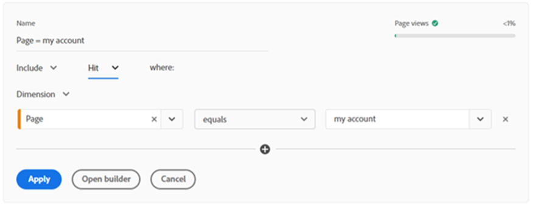
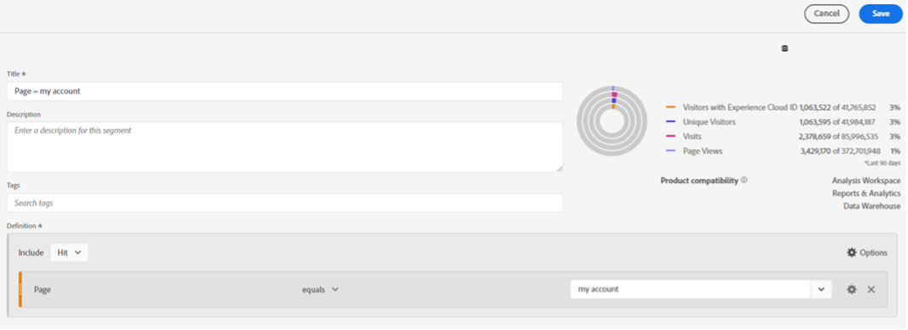
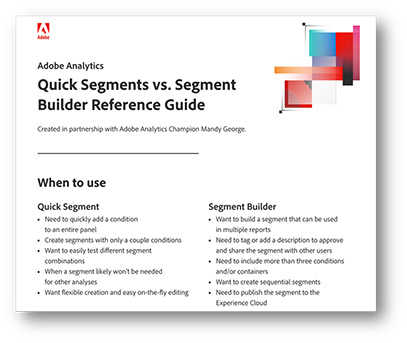

# Analysis Workspaceのセグメントビルダーとクイックセグメントの違い

セグメントは、データ分析ツールキットの最も強力なツールのひとつです。 Analysis Workspaceのセグメントビルダーとクイックセグメントを使用して、効率を向上させる方法の違いを説明します。

>[!TIP]
>
> Analysis Workspaceで各ツールを使用するタイミングに関する便利なリマインダーをダウンロードするには、ページの下部にある画像をクリックします。

セグメントは、データ分析ツールキットの最も強力なツールのひとつです。 特定のトラフィックグループ、サイトセクション、カスタマージャーニーを調査する場合、セグメントを利用することは、サイトへのトラフィックの特定のサブセットに分析を集中させるための優れた方法です。 小売環境で作成した最も有用なセグメントの中には、新規顧客と既存顧客、アカウントにサインインした顧客とゲストなど、様々なタイプの顧客グループ向けのものがあります。 しかし、異なるサイトセクション、特定のアクションを実行する顧客、または考えることができる他の何でも作成することもできます。

**セグメントを作成するには、主に2つの方法があります：**

* コンポーネントメニューでのセグメントビルダーの使用
* パネルの上部にあるクイックセグメントの使用

セグメントビルダーを使用してセグメントを作成した場合は、そのセグメントを保存して他のプロジェクトで再利用できます。 これは、サイトの特定のセクションを訪問して購入する顧客など、特定の顧客グループに集中できる優れた方法です。 一方、探索的分析を実施し、さまざまなセグメント設定をテストする場合は、クイックセグメントビルダーが役立ちます。 各方法の主な利点を見てみましょう。

## クイックセグメント

各パネルの上部にあるクイックセグメントアイコン（+記号の付いたfunnel）をクリックして、ビルダーを開くことができます。 これにより、最大3つの条件を持つ任意のレベル（ヒット、訪問、訪問者）のセグメントを構築できます。 メインセグメントビルダーと同様に、セグメントがデータを返しているかどうか、およびセグメントに含まれるトラフィック全体の割合を示す右側の表示が表示されますが、これはセグメントビルダーに表示されるセグメントボリューム全体の表示よりも簡素化されたバージョンです。 複数の条件を追加する場合は、「and」演算子と「or」演算子を使用できます。 残念ながら、クイックセグメントには「その後」オプションがないので、シーケンシャルセグメントが必要な場合は、セグメントビルダー全体を使用する必要があります。 クイックセグメントには、1つのコンテナの制限もあります。 基本的なセグメントに使用することを意図しているので、すぐに作成して編集できます。 クイックセグメントをパネルに適用するか保存すると、パネル内で編集できなくなります。

探索分析を行う際に、様々なタイプのセグメントをテストして、様々な顧客グループがどのように反応するか、異なるカテゴリがどのように機能するかを確認する必要があります。クイックセグメントを使用することは、セグメントビルダーを使用するよりもはるかに高速です。 さらに、これらのセグメントは、作成されたプロジェクトでのみ使用できるため、目的の結果が得られないことが判明した場合でも、保存したセグメントをマスターリストから削除する必要はありません。 セグメントをテストした後、他のプロジェクトで役立つことが分かった場合は、いつでも「ビルダーを開く」ボタンをクリックして、セグメントビルダー全体でセグメントを開き、通常のセグメントとして保存することができます。 ただし、この操作を行うと、クイックセグメントビルダーで編集できなくなります。

## セグメントビルダー

セグメントビルダーには、左側のコンポーネントのメニューのセグメントのリストの上にある+記号をクリックするか、コンポーネントのドロップダウンをクリックして「セグメントを作成…」を選択することでアクセスできます。クイックセグメントとは異なり、利用可能なすべてのオプションがあります。 複数の条件を追加する場合は、「then」演算子を使用してシーケンシャルセグメントを作成できます。 シーケンシャルセグメントでは、ヒット、訪問、訪問者の代わりに「ロジックグループ」をレベルとして使用することもできます。 セグメントビルダーでは、セグメントに説明を追加することもできます。これにより、セグメントを構築した人やフィルターを適用するために構築されたデータの種類に関するコンテキストを追加したり、セグメントに「タグ」を追加して組織目的で追加したりできます。これらはいずれもクイックセグメントビルダーでは不可能です。

セグメントビルダーを使用することは、セグメントに3つ以上の条件がある場合、コンテナを使用する必要がある場合、またはシーケンシャルセグメントが必要な場合に不可欠です。 セグメントビルダーには、より複雑なセグメントを作成するための多くのオプションが用意されており、さまざまな顧客タイプ、カテゴリー、カスタマージャーニーなどを分類するのに役立ちます。 これらのセグメントを作成して保存すると、セグメントのマスターリストに追加されます。つまり、タグ付け、承認、共有、複数のレポートでの使用、Experience Cloudへの公開が可能です。 Experience Cloudで公開すると、パーソナライゼーションのターゲティングに[!DNL Adobe] Targetなど、他の[!DNL Adobe]製品でセグメントを利用できます。 セグメントビルダーで作成したセグメントは、クイックセグメントパネルで編集できません。セグメントビルダーを開いて変更を加える必要があります。 幸いなことに、右側のプレビュービジュアライゼーションでは、過去90日間にセグメントが取り込んだトラフィックをより詳細に分析できるため、保存前にセグメントが必要なものを取り込んでいることを確認しやすくなります。

## ユースケース

業界によって、カスタムセグメントを構築する用途は異なるかもしれません。 大規模なretailerのe コマース部門では、顧客が購入に至るまでの経路を決定するために、しばしば探索分析を行います。 カートへの商品の追加や注文など、アクションで急増や減少が見られる場合、ここでクイックセグメントを使用すると便利です。 分析時に、特定のタイプの顧客や、顧客がクリックする特定のアクション/リンクのセグメントをすばやく作成できます。 セグメントビルダーを開いて各セグメントを保存する必要がないため、条件をすばやく追加し、すぐに削除できます。 これにより、サイトで変更を確認する理由を説明する際の時間を大幅に節約できます。

あるいは、セグメントビルダーが私の頼りとなったこともあります。 あらゆる顧客が同じわけではありません。多くの場合、特定のタイプの顧客を、その顧客の行動や経路によって特定したいと考えています。 セグメントビルダーを使用することで、複数の条件を追加して様々なタイプの顧客を特定し、セグメントを保存して、複数のアナリストが共有して使用できるようにすることができます。 これらのセグメントは、レポート全体で一貫性を持たせることが重要です。そのため、全員が使用できるようにセグメントを構築することは、それぞれのセグメントを構築する人よりも優れています。結果が異なる場合もあります。

全体として、クイックセグメントとセグメントビルダーの両方は、分析で使用するための優れたツールです。 それぞれに目的、利点、欠点があります。 クイックリファレンスガイドについては、以下の便利なダウンロード可能なヒントとテクニックのシートを必ず確認してください。

## 作成者

この文書の作成者：

**Mandy George**、Best Buy Canadaのデジタルアナリスト III

Adobe Analytics Champion

## ダウンロード

[] （assets/ Adobe_Analytics_Segments_Vs_Segment_Builder_Reference_Guide.pdf）
